# Cutive Mono Cyrillic 6.020 — пакет для внешнего типографического ревью

Это диагностический пакет по **установленной** V6. Шрифт, исходники,
Fontconfig, fallback и системная установка не изменялись. Все изображения
отрисованы из установленного файла; ничего не пересобрано и не подменено.

## Проверенная версия

| | |
|---|---|
| Семейство | **Cutive Mono Cyrillic** |
| Версия | **6.020** |
| Version string | `Version 6.020; ttfautohint (v1.8.4.16-eb64)` |
| Font Revision | `6.020004` |
| Установленный файл | `/home/sora/.local/share/fonts/CutiveMonoCyrillic/CutiveMono-Cyrillic-Regular.ttf` |
| Формат | TrueType (TTF) |
| SHA-256 | `aaf8154e9983c661e88c4a3769266d2c4c1f3ff55a2cc063c5f1f397faac55f7` |
| Глифы / cmap | 582 / 577 |
| Латиница / кириллица | 452 / 128 |
| UPM | 2048 |
| Advance | 1240 (16 combining — 0; periodcentered — 165) |

Копии: `fonts/installed-v6.ttf` (SHA-256 совпадает с установленным),
`fonts/original-cutive-mono.ttf` (оригинальный Cutive Mono 1.110). Подробности —
[`fonts/README.md`](fonts/README.md).

## Заглавная кириллица

[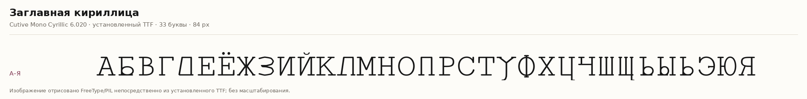](screenshots/01-full-cyrillic-uppercase.png)

## Строчная кириллица

[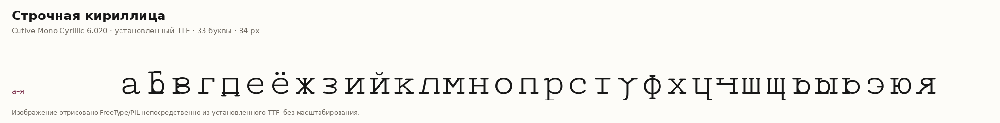](screenshots/02-full-cyrillic-lowercase.png)

## Русские контрольные строки

[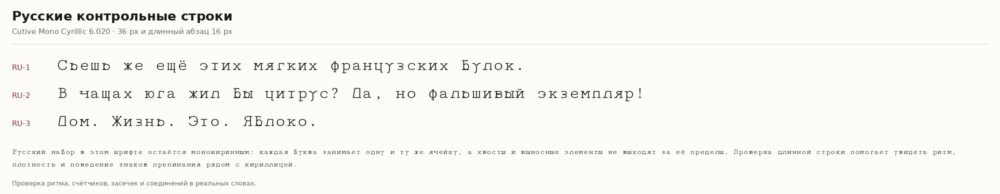](screenshots/03-russian-sentences.png)

## Смешанный текст EN/RU

[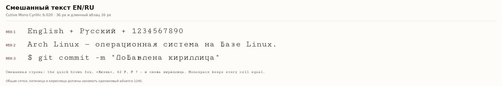](screenshots/04-mixed-language.png)

## Проблемные глифы крупным планом

19 обязательных пар + Д/д. Латинские ориентиры — только для сравнения.

[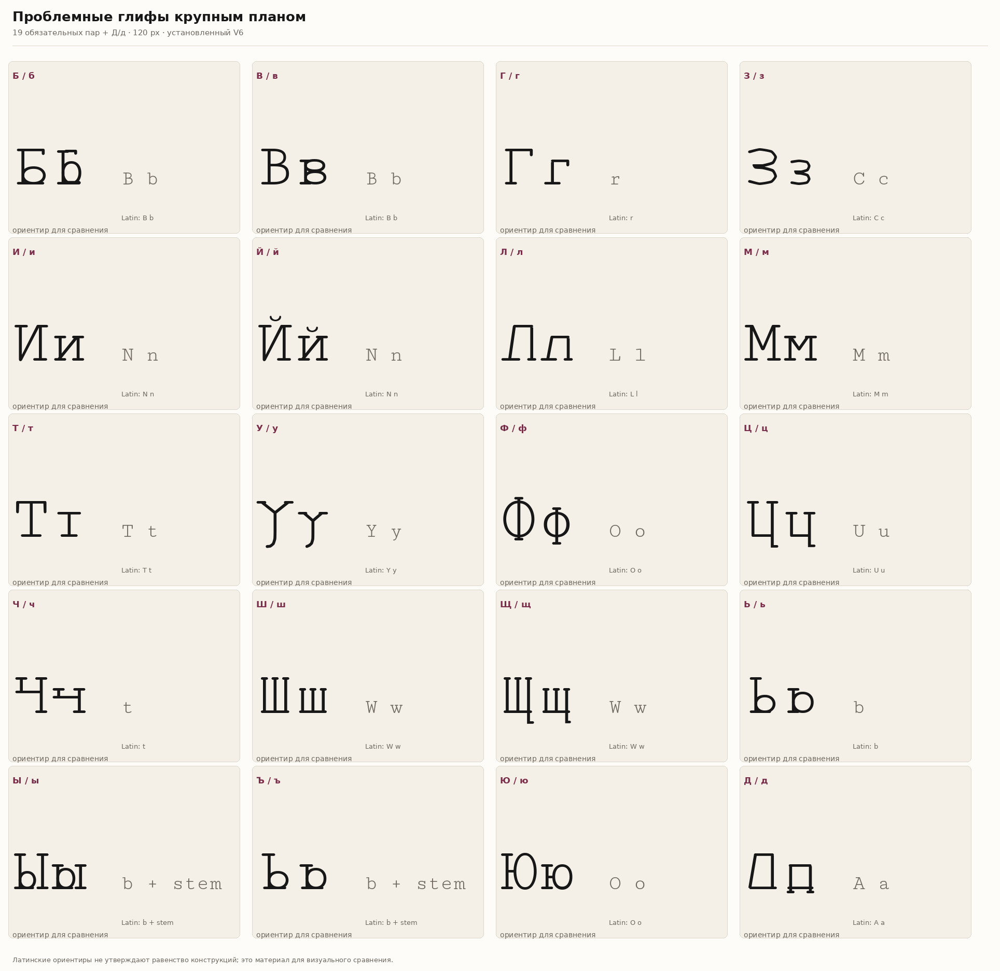](screenshots/05-problematic-glyphs.png)

## Ц и ц — отдельный разбор

U-образное тело (П/п, перевёрнутая по вертикали), нижний выносной, соединения,
засечки и сравнение с Ч/ч, Ш/ш, Щ/щ.

[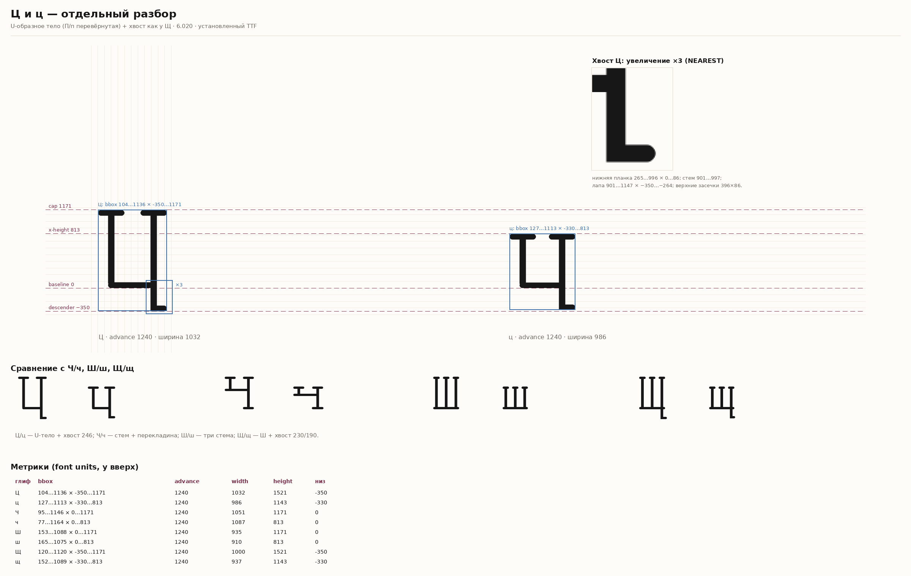](screenshots/06-tsa-review.png)

## Малые кегли 11–12 px

Фактический растр и увеличение NEAREST ×3 — без сглаживания, скрывающего пиксели.

[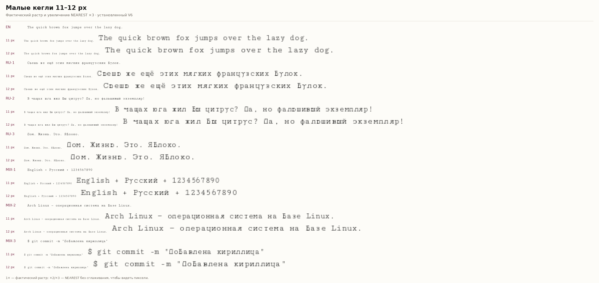](screenshots/07-small-size-11-12px.png)

## Рабочие кегли 13–14 px

[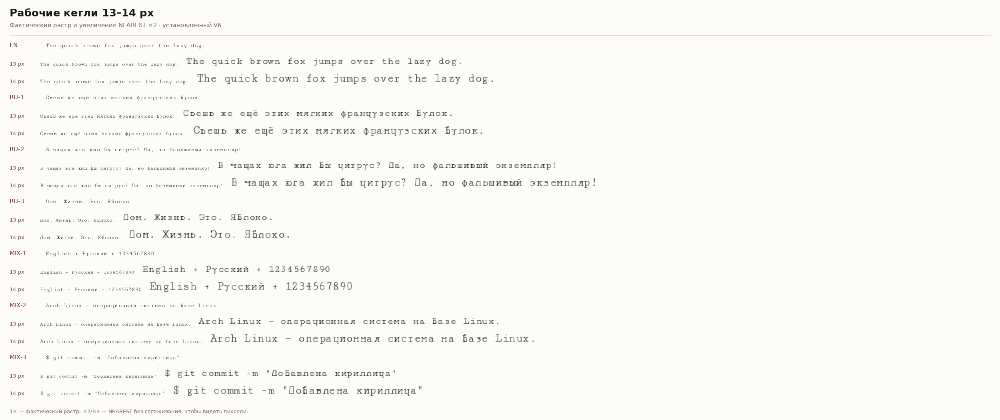](screenshots/08-normal-size-13-14px.png)

## Крупные кегли 16–24 px

[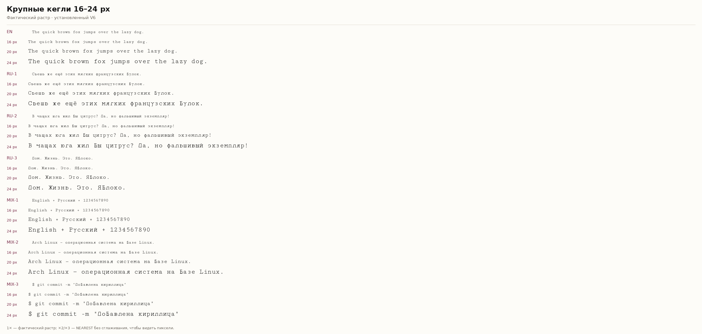](screenshots/09-large-size-16-20px.png)

## Реальные приложения

### foot, 14 px

Установленный V6 выбран через fontconfig; кириллица, латиница и Nerd-иконки
отрисованы. Это фактический скриншот окна foot, без имитации.

[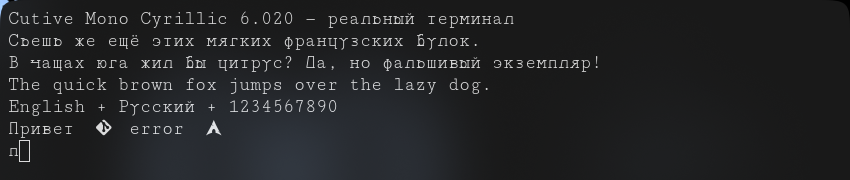](screenshots/10-foot.png)

### kitty, 14 px

Запуск был, но окно оказалось перекрыто полноэкранной игрой; валидный
скриншот не получен. **Визуальная проверка kitty не подтверждена** — результат
не имитируется. Когда игра будет закрыта, проверку можно повторить.

## Техническое замечание: U+04B6/04B7

`Ҷ`/`ҷ` (Che with descender) в шрифте совпадают с `Ӂ`/`ӂ` (Zhe with breve):
`yMin = 0`, тогда как у Che with descender должен быть descender. Это есть
в V5, 6.010 и 6.020; в 6.020 не исправлялось. Подробности —
[`V6-TECHNICAL-REPORT.md`](V6-TECHNICAL-REPORT.md), раздел 11.1.

[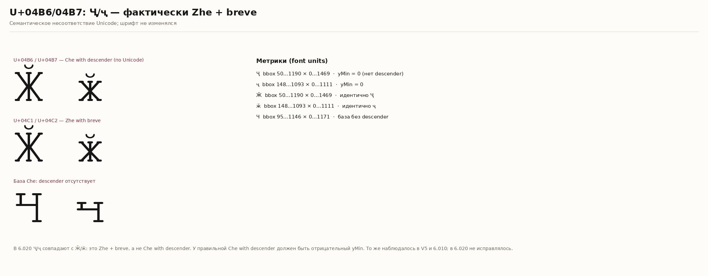](screenshots/11-extended-issue.png)

## Отчёты

- [`V6-TECHNICAL-REPORT.md`](V6-TECHNICAL-REPORT.md) — версия, путь, SHA-256,
  формат, покрытие, advance, моноширинность, NFC/NFD, GSUB/GPOS, Fontconfig,
  Nerd fallback, технические проблемы.
- [`V6-GLYPH-AUDIT.md`](V6-GLYPH-AUDIT.md) — таблица оценок по каждому
  проблемному глифу: что хорошо, что плохо, рекомендация.
- [`V6-GLYPH-METRICS.csv`](V6-GLYPH-METRICS.csv) — метрики 146 строк:
  128 кириллических + 16 combining + №/₽.
- [`V6-COMPARISON.md`](V6-COMPARISON.md) — V5 → V6.020 и оригинальная латиница.
- [`fonts/README.md`](fonts/README.md) — копии шрифтов, SHA-256, лицензия.

## Что проверялось

- 452/452 латинских глифов: контуры не изменены.
- 128/128 кириллических кодпоинтов; 128/128 хинченных.
- advance 1240 у 560 глифов; 0 у 16 combining; 165 у periodcentered.
- NFC/NFD: 28/28 пар; GPOS-фолбэк для `а+acute`, `щ+acute`, `с+cedilla`.
- GSUB: `aalt case ccmp frac liga locl ordn sups`; GPOS: `kern mark mkmk`.
- Лигатуры `fi`/`fl`, дроби `1/2`, `ordn`; `liga` выключается.
- cmap: две format 4 субтаблицы, без дубликатов и multi-mapped глифов.
- `pathops.simplify`: 128/128; `audit.py`: clean.
- TTF и проектный OTF: round-trip save → reload.
- Fontconfig: `fc-match` и `fc-scan`; Nerd fallback — системный, не встроенный.
- foot 14 px — подтверждён; kitty 14 px — не подтверждён (см. выше).

## Ограничения

Печать, PDF, Firefox/Safari, все терминалы и DPI-режимы не проверялись.
`ots-sanitize` и `hb-shape` не установлены. Художественная оценка — только
материал для внешнего ревью; в этом пакете нет приказа на редизайн.
